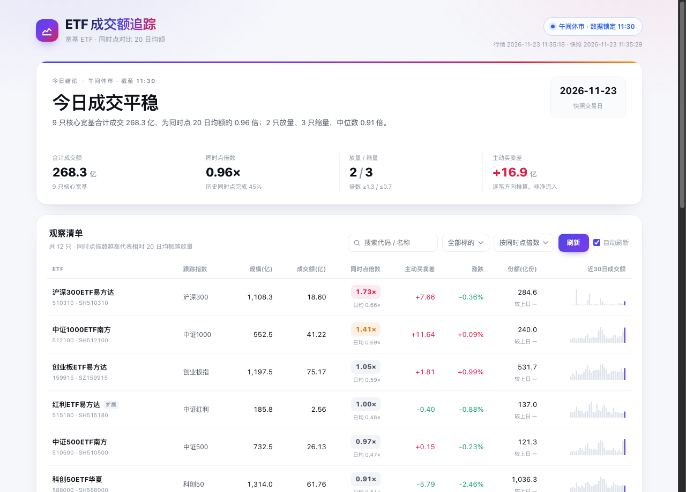

# ETF 成交额追踪

> 宽基 ETF 成交额与 20 日均额的「同时点」对比，用来快速判断今天是否放量。



纯静态页面 + 一个 Python 抓数脚本，没有框架、没有数据库、没有后端服务。双击 `index.html` 就能看，也能直接部署到 GitHub Pages。

## 功能

- **今日结论**：核心宽基合计成交额、同时点倍数、放量/缩量只数、主动买卖差
- **观察清单**：12 只宽基 ETF，可搜索、按范围筛选、按倍数/成交额/涨跌/规模排序
- **放量排行**：横向条形图，1.0× 基准线，一眼看出谁在放量
- **盘中实时**：交易时段每 20 秒通过腾讯行情刷新（JSONP，无跨域问题）
- **零依赖**：Python 只用标准库，前端只用原生 JS

## 快速开始

要求 Python 3.8+，不需要安装任何第三方包。

```bash
# 1. 抓取行情、计算 20 日均额、生成 data/snapshot.js
python3 scripts/update_data.py

# 2. 打开页面
open index.html          # macOS
# 或者起一个本地静态服务（可选）
python3 -m http.server 8000
```

页面会先渲染快照，再尝试连实时行情。直接双击 `index.html` 也可以，`data/snapshot.js` 是本地脚本，不受 `file://` 的 fetch 限制。

## 目录结构

```
etf/
├── index.html                # 页面结构
├── assets/
│   ├── app.js                # 渲染、排序、实时刷新、同时点对齐
│   └── style.css             # 样式（响应式）
├── config/etfs.json          # 标的清单与分组
├── scripts/update_data.py    # 抓行情 → 算指标 → 写快照
├── data/
│   ├── snapshot.js           # 生成物：window.SNAPSHOT
│   └── shares_history.json   # 每日收盘份额（申赎计算用）
├── docs/preview.png
└── .github/workflows/update.yml
```

## 数据口径

### 同时点对齐（核心）

上午 11:30 的成交额只有半天，直接除以「全天 20 日均额」会得到毫无意义的低倍数。页面的做法是：

1. 取每只 ETF 近 20 个完整交易日的 5 分钟 K 线；
2. 按日算出「累计成交额 ÷ 全天成交额」在 48 个时点上的曲线；
3. 对 20 天取平均，得到该标的的日内成交节奏；
4. 盘中用当前时刻查表，得到「平均已走完全天的比例」`p`；
5. 同时点倍数 = `当前成交额 ÷ (20 日均额 × p)`。

分母和分子都代表「到此刻为止」，可以直接比较。表格里的小字「日均 ×」是原始进度 `当前成交额 ÷ 20 日均额`，只作参考。

### 20 日均额

由新浪 5 分钟 K 线的逐日成交额汇总得到，取快照交易日**之前**的 20 个完整交易日；每天的 48 根 5 分钟 K 线必须齐全，否则跳过。已与日 K 成交量 × 均价交叉核对，误差小于 1%。

### 实时行情

腾讯 `qt.gtimg.cn`，以 `<script>` 方式加载，接口返回 `v_sh510300="..."` 的全局变量赋值，因此不受 CORS 限制。字段以 `~` 分隔，GBK 编码：

| 字段 | 含义 |
| --- | --- |
| 1 / 2 / 3 / 4 | 名称 / 代码 / 现价 / 昨收 |
| 7 / 8 | 外盘 / 内盘（手） |
| 30 / 32 | 时间戳 / 涨跌幅 |
| 37 | 成交额（万元） |
| 45 | 总市值（亿元） |
| 72 | 场内总份额（股） |

### 主动买卖差（推算）

`(外盘 − 内盘) ÷ (外盘 + 内盘) × 成交额`。外盘是主动买、内盘是主动卖，这只是逐笔成交方向的推算：**不是资金净流入，不是基金申赎，也不含大宗交易**。ETF 一二级市场套利会稀释该信号。

### 份额 / 申赎

份额来自腾讯行情的场内份额。申赎 = `(本次快照份额 − 上一快照份额) × 现价`，是份额变化的市值估算，需要连续两日运行脚本才有值。

脚本**只在收盘后（15:05 之后）记录份额**，避免盘中不完整的快照污染次日计算；周末运行会记录最近交易日的收盘份额。

## 配置自己的标的

编辑 `config/etfs.json`：

```json
{
  "title": "宽基 ETF 成交额追踪",
  "items": [
    {
      "code": "510300",
      "tcode": "sh510300",
      "name": "沪深300ETF华泰柏瑞",
      "index": "沪深300",
      "group": "core"
    }
  ]
}
```

| 字段 | 说明 |
| --- | --- |
| `code` | 6 位代码，用于表内匹配 |
| `tcode` | 带市场前缀：沪市 `sh`、深市 `sz` |
| `name` | 展示名称 |
| `index` | 跟踪指数 |
| `group` | `core` 计入今日结论；`extended` 只展示、不计入 |

改完后重新运行 `python3 scripts/update_data.py`。

## 部署到 GitHub Pages

1. 提交并推送：

   ```bash
   git add .
   git commit -m "feat: ETF turnover tracker"
   git push -u origin main
   ```

2. 仓库 **Settings → Pages → Build and deployment**：
   - Source 选 **Deploy from a branch**
   - Branch 选 `main`，目录选 `/ (root)`
   - 保存后访问 `https://<你的用户名>.github.io/etf/`

3. 打开 **Actions** 标签页，允许 workflow 运行；在 **Settings → Actions → General → Workflow permissions** 里选中 **Read and write permissions**，自动更新才能提交数据。

没有构建步骤，`index.html` 在根目录，`data/snapshot.js` 会被一起发布。

## 自动更新

`.github/workflows/update.yml` 会在每个工作日 **15:35（北京时间）** 运行：

```yaml
schedule:
  - cron: "35 7 * * 1-5"   # UTC 07:35 = 北京 15:35
```

- GitHub 的定时任务可能延迟几分钟到十几分钟，属正常现象
- 也可以在 Actions 页面手动 **Run workflow**
- 节假日运行不会出错，只会把快照更新为最近一个交易日
- 数据没有变化时不会产生空提交
- 定时任务使用仓库自带的 `GITHUB_TOKEN`，无需额外配置密钥

## 已知限制

- **沪市份额不一定日更**：实测部分交易日沪市 ETF 的份额字段整片不变，这通常不是「没有申赎」，而是行情源未更新。看到整列不变时不要下结论。
- **新浪 5 分钟 K 线会限流**：脚本对每只 ETF 重试 3 次；仍失败时沿用上一份快照的 20 日均额与日内曲线，并在快照里标记 `basis_stale`。
- **首次运行没有申赎**：需要连续两个收盘日的数据，`shares_history.json` 积累后才会显示。
- **份额与规模是行情口径**：规模 = 价格 × 场内份额，不是基金净值；与基金公司公告可能不一致。
- **接口可能变更**：第三方公开接口没有稳定性承诺，字段或限流策略变化时需要调整 `scripts/update_data.py`。

## 下一步可以加

- 份额变化柱状图 / 加仓指数（需要积累一段时间的 `shares_history.json`）
- 单只 ETF 详情页（成交额趋势、日内曲线）
- 自选列表与本地偏好（`localStorage`）
- 收盘后自动生成当日复盘文案

## 免责声明

本项目仅用于个人研究和技术演示。页面所有结论均为基于公开行情的量价推测，不能证明任何机构当日是否交易，**不构成投资建议**。行情数据来自腾讯、新浪等第三方公开接口，可能延迟、缺失或存在口径差异，请以基金公司公告与交易所披露为准。投资有风险。
